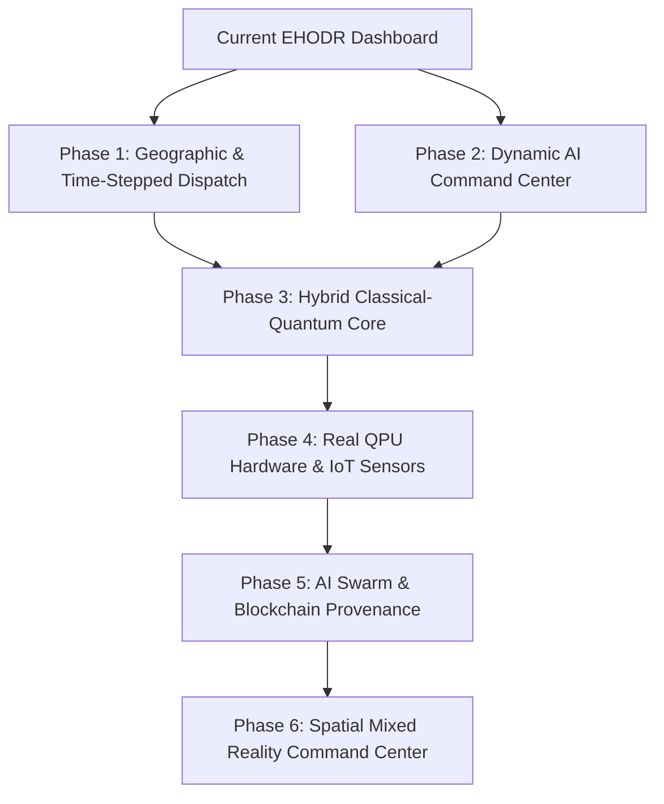

# 🚀 Visionary Engineering Roadmap: Future of EHODR

This document outlines the evolutionary architectural roadmap for the **Emergency Hospital Resource Optimizer (EHODR)**. It covers advanced feature integrations, real quantum hardware routing, geographic dispatch, time-stepped simulation engines, and IoT infrastructure integration to transition the platform into an enterprise-grade disaster command suite.

---

## 🗺️ Architectural Phase Map

---

## 🤖 Phase 1: Real-Time AI Dispatch & Coordinator Chatbot

### A. Local Ollama Integration
* **Objective**: Introduce an interactive conversational interface that acts as an "Emergency Operations Center (EOC) Command Advisor."
* **Technical Specification**:
  * Utilize the local Ollama API gateway (already initialized in UAMS) to run open-weight models (e.g., `Llama-3-8B` or `Mistral-7B`) offline.
  * Dynamically extract active allocation tables, distance matrices, and capacity metrics from the Streamlit session state and inject them as context into the LLM system prompt.
* **Core Capabilities**:
  * **Allocation Reasoning**: Explain *why* a specific patient was routed to a farther hospital (e.g., *"Patient-3 is critical but was routed to H2 because Hospital H1’s ICU beds are currently 100% saturated"*).
  * **Resource Warning**: Alert operators of active system bottlenecks (e.g., *"Warning: Regional Medical Staff is at 92% utilization; any further critical incoming cases will trigger triage delays"*).

---

## 🗺️ Phase 2: GIS Real-World Interactive Mapping

### A. Geocoded Spatial Routing
* **Objective**: Transition from abstract distance matrices to real-world GIS coordinates.
* **Technical Specification**:
  * Integrate `folium` and `streamlit-folium` to display interactive spatial maps.
  * Map real hospital coordinates and generate mock patient pickup locations within a selectable metropolitan area (e.g., Seattle, New York, or London).
  * Use open routing APIs (like OpenStreetMap/OSRM) to calculate actual travel time profiles instead of linear Euclidean distances.
* **Visual Telemetry**:
  * **Hospital Nodes**: Displayed as dynamic pins. Green pins represent low occupancy, turning orange and blinking red as they hit 90%+ saturation.
  * **Patient Nodes**: Represented by color-coded circles matching their triage severity levels (Red = Severity 3, Yellow = 2, Green = 1).
  * **Dispatch Paths**: Draws active polyline paths mapping patients from coordinate origins to assigned hospital hubs in real-time.

---

## ⏰ Phase 3: Multi-Stage Time-Stepped Simulation

### A. 24-Hour Continuous Emergency Timeline
* **Objective**: Evolve the optimizer from a single static snapshot into a continuous time-series simulation.
* **Technical Specification**:
  * Divide the optimization horizon into discrete time blocks (e.g., 10-minute intervals over a 24-hour cycle).
  * Patients arrive dynamically based on an adjustable casualty curve (e.g., normal or Poisson distribution representing peak disaster arrivals).
  * Hospitals slowly treat and discharge minor patients over time, freeing up beds.
  * **Dynamic Re-Optimization**: Run the Simulated Annealing or classical solver at every time step to re-triage incoming cases, showing a live timeline playback of fluctuating capacities.

---

## 🚑 Phase 4: Multi-Modal Transport Dispatch

### A. Vehicle Asset Management
* **Objective**: Include vehicle limitations in the mathematical optimization constraints.
* **Vehicle Classes**:
  * **Standard Ambulances**: Plentiful, but travel slowly along ground routes (high distance cost penalty).
  * **Air-Rescue Helicopters**: Extremely fast, bypassing road blockages (zero distance penalty), but extremely limited in quantity.
* **QUBO Mathematical Extension**:
  * Expand the binary decision variable from $x_{p,h}$ (patient $p$ to hospital $h$) to $x_{p,h,v}$ where $v \in \{Ambulance, Helicopter\}$.
  * Incorporate vehicle availability constraints:
    $$\sum_{p,h} x_{p,h,Helicopter} \le \text{Total Helicopters}$$

---

## ⛈️ Phase 5: Environmental & Disaster Road Blockages

### A. Dynamic Terrain Routing Risks
* **Objective**: Simulate severe weather or physical terrain blockages that disrupt transportation networks.
* **Interactive Sliders**:
  * Add a **Disruption Severity** slider (Clear, Severe Flooding, Seismic Damage, Road Obstructions).
* **The Impact**:
  * Selecting "Severe Flooding" marks specific routes or coordinate zones on the map as "Blocked."
  * The system dynamically recalculates the distance matrix, scaling blocked pathways to infinity ($\infty$) and forcing the solvers to route patients through safe bypass roads to other hospitals.

---

## 🌀 Phase 6: Deeper Quantum Control Panel (The Ansatz Lab)

### A. Qiskit Solver Parameter Customizer
* **Objective**: Provide quantum developers and judges with low-level parameter tuning capabilities.
* **Parameter Controls**:
  * **Classical Minimizers**: Let users choose the classical optimizer used by Qiskit to tune the parameterized quantum gates (e.g., `COBYLA`, `SLSQP`, `SPSA`, or `Nelder-Mead`).
  * **Ansatz Layers (Reps)**: Increase layers to observe quantum state convergence profiles.
  * **Quantum Mixer Hamiltonians**: Toggle between standard $X$-Mixers and complex $XY$-Mixers to verify search space constraints.
  * **Noise Simulation Engine**: Add a toggle to simulate real hardware gate errors, illustrating how the algorithm performs on imperfect, real-world NISQ (Noisy Intermediate-Scale Quantum) devices.

---

## 🔌 Phase 7: Real Physical Quantum Hardware Execution

### A. IBM Quantum Hub Integration
* **Objective**: Evolve the quantum solver from classical simulators to real, physical superconducting quantum computers.
* **Technical Specification**:
  * Integrate Qiskit Runtime Services (`qiskit-ibm-runtime`).
  * Add a secure API key field in the sidebar to let users authenticate their IBM Quantum accounts.
  * Add a **Target Hardware** dropdown to select active IBM QPUs (e.g., `ibm_brisbane`, `ibm_kyoto`).
* **Visual Telemetry**:
  * When executing, display real-time physical QPU queue wait times, active job IDs, and physical read-out error mitigation parameters.
  * Display a side-by-side comparison of Simulators vs. Real Hardware Cost accuracy.

---

## 📡 Phase 8: IoT Sensor Real-Time Capacity Sync

### A. Automated Resource Tracking
* **Objective**: Eliminate manual input sliders and synchronize hospital resources in real-time.
* **Technical Specification**:
  * Connect the Streamlit dashboard to a real-time database (e.g., Supabase or PostgreSQL) linked to smart IoT medical equipment.
  * **IoT Smart Beds**: Automatically update regional bed counts as physical pressure-sensor pads on beds register a patient.
  * **IoT Ventilator Status**: Automatically decrement ventilator availability the moment an active mechanical breathing loop is initiated in an ICU ward.
  * This creates a fully automated, hands-free regional dispatch coordinator.

---

## 🤖 Phase 9: Multi-Agent AI Swarm Dispatchers

### A. Autonomous Collaborative Triage & Routing
* **Objective**: Introduce a collaborative multi-agent AI swarm to manage dynamic triage, transport, and clinical preparation autonomously.
* **Technical Specification**:
  * Utilize agentic frameworks (e.g., LangGraph or AutoGen) to launch a decentralized coordinator swarm:
    * **Paramedic Agent**: Monitors active cockpit EKG telemetry and submits secure en-route diagnostic files.
    * **Hospital Logistics Agent**: Tracks real-time smart beds and ventilator states, automatically negotiating emergency intake queues.
    * **GIS Dispatch Agent**: Constantly monitors municipal traffic, weather disruptions, and blocked route vectors.
    * **Weather Monitor Agent**: Watches storm progress to alert of impending blockages or power failures.
  * **Core Capabilities**:
    * Instead of a single static solver call, the agents hold a dynamic negotiation debate to allocate arriving patients based on clinical suitability and live resource constraints.

---

## 📈 Phase 10: Deep Reinforcement Learning Policy Core

### A. Dynamic Policy Optimization
* **Objective**: Evolve the static classical and quantum solver parameters using Deep Reinforcement Learning (DRL) models trained on past mass casualty incidents.
* **Technical Specification**:
  * Implement a **Deep Q-Network (DQN)** or **Proximal Policy Optimization (PPO)** agent inside the core solver engine.
  * Train the model inside a simulated environment where incoming Poisson casualty waves, weather blockages, and clinical bottle-necks fluctuate continuously.
  * **Parameter Auto-Tuning**: The RL agent dynamically adjusts the QUBO penalty coefficients ($A$ and $B$) and severity distance weights in real-time based on system-wide survival rates, matching allocation strategies to the disaster type.

---

## ⛓️ Phase 11: Privacy-Preserving Blockchain Provenance

### A. Immutable Patient Triage Trails
* **Objective**: Guarantee absolute data integrity, audit trails, and privacy compliance for patient logs across multiple hospital jurisdictions.
* **Technical Specification**:
  * Integrate a permissioned ledger (e.g., **Hyperledger Fabric**) to log patient triage admissions, telemetry logs, and en-route paramedic medication delivery immutably.
  * **Zero-Knowledge Proofs (ZKPs)**: Use cryptographic ZKPs to verify patient severity levels, priority ranks, and triage qualifications without exposing names or sensitive personal identifiable information (PII) on the ledger.
  * **Smart Contracts**: Auto-execute trauma bay reservations and clinical specialist paging the moment a patient passes a secure verification check en route.

---

## 🥽 Phase 12: Spatial Mixed Reality Tactical Command Center

### A. AR/VR EOC Hologram Map
* **Objective**: Provide disaster response chiefs with a fully immersive, 3D spatial computing tactical command center (compatible with Apple Vision Pro or Meta Quest 3).
* **Technical Specification**:
  * Deploy a WebXR-compatible spatial interface rendering real-world OSRM roads, geocoded hospital structures, and active ambulance positions in a three-dimensional hologram space.
  * **Immersive Controls**:
    * Operators can pinch and grab patient nodes in spatial 3D to view active fluctuating vitals.
    * Drag-and-drop ambulances to alternative routes to bypass physical terrain flood blockages.
    * The backend continuously computes active quantum QAOA allocations, rendering updated optimal paths dynamically in the operator's physical room space.

