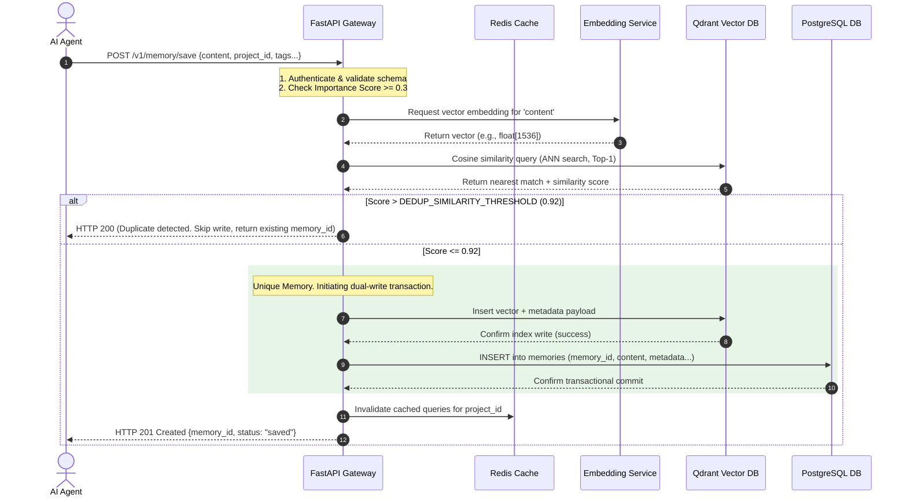
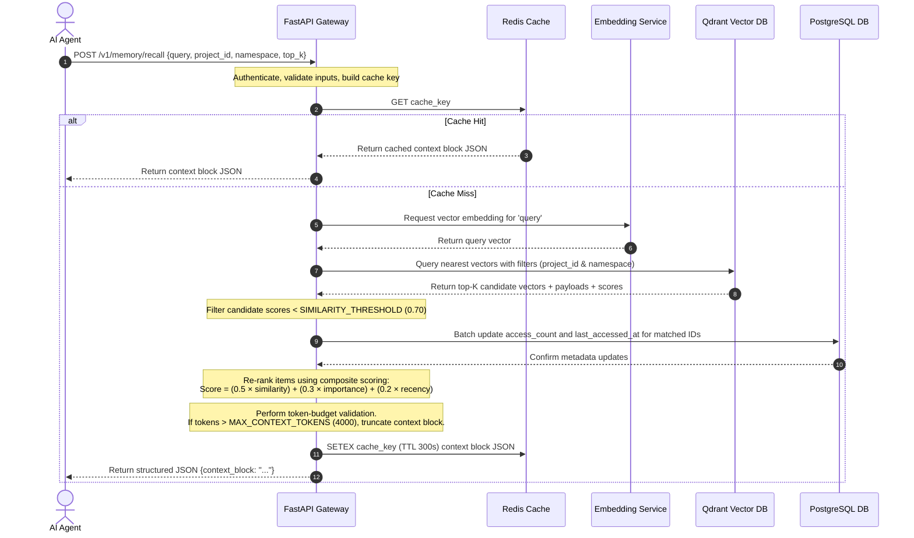
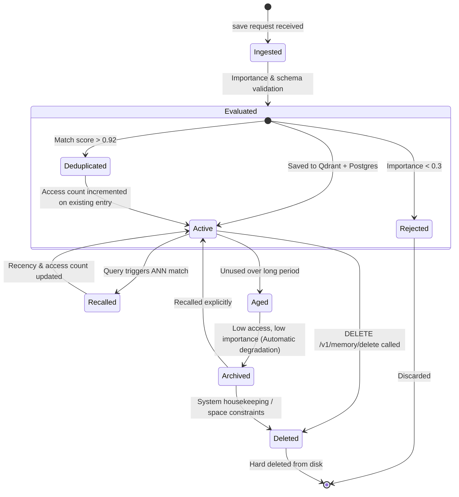

# System Architecture & Service Map Specification

This document serves as the immutable blueprint and technical specification for the Universal AI Memory System. It outlines the service topology, interface boundaries, communication protocols, port allocations, operational data flows, and the lifecycle of persistent memory entries.

---

## 1. System Architecture Diagram

Below is the verified system architecture diagram representing the data flows and service boundaries:

```text
                     ┌─────────────────────────────────────────────────────────┐
                     │                      AI AGENTS LAYER                     │
                     │  OpenAI Agents │ Claude │ Gemini │ Local LLMs │ MCP     │
                     └─────────────────────────┬───────────────────────────────┘
                                               │ HTTP/REST (JSON)
                                               ▼
                     ┌─────────────────────────────────────────────────────────┐
                     │               MEMORY GATEWAY API (FastAPI)               │
                     │  • Auth middleware      • Rate limiting                  │
                     │  • Request validation   • Structured logging             │
                     │  • API versioning (/v1) • Async request handling         │
                     │  Routes:                                                 │
                     │    POST /v1/memory/save                                  │
                     │    POST /v1/memory/recall                                │
                     │    POST /v1/memory/search                                │
                     │    DELETE /v1/memory/delete                              │
                     │    POST /v1/chat                                         │
                     │    GET  /v1/health                                       │
                     └──────────┬──────────────────────────┬───────────────────┘
                                │                          │
                                ▼                          ▼
                     ┌──────────────────┐      ┌───────────────────────────────┐
                     │  EMBEDDING       │      │         REDIS CACHE            │
                     │  SERVICE         │      │  • Query result caching        │
                     │  (configurable)  │      │  • Rate limit counters         │
                     │  Produces:       │      │  • Session state               │
                     │  float[] vectors │      └───────────────────────────────┘
                     └──────────┬───────┘
                                │ vectors
                                ▼
                     ┌─────────────────────────────────────────────────────────┐
                     │                    QDRANT (Vector DB)                     │
                     │  Collections per project_id + namespace                  │
                     │  • Cosine similarity search                              │
                     │  • Metadata filtering                                    │
                     │  • ANN indexing (HNSW)                                   │
                     │  • Persistent volume-backed storage                      │
                     └──────────┬──────────────────────────┬───────────────────┘
                                │                          │
                                ▼                          ▼
                     ┌──────────────────┐      ┌───────────────────────────────┐
                     │   POSTGRESQL     │      │       PERSISTENT STORAGE       │
                     │  • Memory        │      │    (Docker named volumes)      │
                     │    metadata      │      │    qdrant_data, pg_data        │
                     │  • User/project  │      └───────────────────────────────┘
                     │    registry      │
                     │  • Audit logs    │
                     └──────────────────┘
```

---

## 2. Service Responsibility Matrix

| Service | Primary Responsibility | Critical Interfaces | Storage / State |
| :--- | :--- | :--- | :--- |
| **FastAPI Gateway** | Orchestration, request validation, API routing, authentication, structured JSON logging, rate-limit enforcement. | Exposes REST endpoints to AI Agents. Calls Embedding Service, PostgreSQL, Redis, and Qdrant. | Stateless. Operations are fully asynchronous. |
| **Embedding Service** | Translates natural language string content into dense, high-dimensional floating-point vector representations. | Interfaced via standard SDKs / HTTP clients (e.g., OpenAI API, Local HuggingFace/Ollama). | Configuration-driven. Caches identical requests where applicable. |
| **Qdrant (Vector DB)** | High-performance approximate nearest neighbor (ANN) vector search, cosine similarity metrics, and payload metadata filtering. | Interfaced via Qdrant Async gRPC/HTTP SDK. Organized in collections isolated by `project_id`. | Stateful. Backed by `qdrant_data` persistent volume. Uses HNSW indexes for payloads. |
| **PostgreSQL** | Relational source of truth for all memory metadata, project registers, API key credentials, and operation audit trails. | Interfaced via async SQLAlchemy engine + `asyncpg` driver. | Stateful. Backed by `pg_data` persistent volume. |
| **Redis** | In-memory cache layer for accelerating repeating recall queries and enforcing API rate-limits. | Interfaced via async `redis-py` client. | Ephemeral state. Configured with a LRU eviction policy. |
| **Nginx (Prod)** | Reverse proxy, SSL/TLS termination, request size limiting, header sanitization, and upstream gateway failover. | Interfaced via external HTTPS port 443. Proxies traffic to internal Gateway port 8000. | Stateless. Logs shipped to system stdout/stderr. |

---

## 3. Port Allocation Table

The system reserves the following ports for containerized internal and host-exposed communication. Development environment exposures are isolated and strictly mapped.

| Service | Internal Port | External Port (Dev) | Protocol | Purpose / Description |
| :--- | :--- | :--- | :--- | :--- |
| **FastAPI Gateway** | `8000` | `8000` | HTTP | Primary application API endpoint |
| **Qdrant HTTP** | `6333` | `6333` | HTTP | Qdrant Web UI, health checks, rest API |
| **Qdrant gRPC** | `6334` | `6334` | gRPC | High-throughput async vector writes/queries |
| **PostgreSQL** | `5432` | `5432` | TCP | Relational database administration and access |
| **Redis** | `6379` | `6379` | TCP | In-memory caching and rate-limiting store |
| **Nginx (Prod)** | `80` / `443` | `80` / `443` | HTTP/S | Production TLS termination and reverse proxy |

---

## 4. In-Depth Operational Data Flows

### A. Memory Save Flow (Ingestion Pipeline)
This pipeline ensures structured, high-value, deduplicated context is securely written to storage.



### B. Memory Recall Flow (Retrieval Pipeline)
This pipeline optimizes context matching, scores relevance dynamically, and ensures token-safety prior to prompt injection.



---

## 5. Memory Lifecycle Specifications

Every piece of information persisted within the memory architecture undergoes a structured, observable lifecycle:



### In-Depth Lifecycle States:

1. **Ingestion & Inception (`POST /v1/memory/save`):**
   - The memory begins as a raw string generated by an agent's reasoning.
   - An importance score (0.0 to 1.0) is assigned by the writing agent. Entries with score `< 0.3` are rejected immediately as ephemeral noise.
   - The data is mapped to a standard `MemoryEntry` schema, specifying isolation values (`project_id`, `namespace`).

2. **Deduplication Check (The "Gatekeeper" state):**
   - A cosine similarity lookup is executed against the Qdrant collection of the target `project_id`.
   - If a memory matches an existing entry with `similarity > 0.92`, the ingestion is skipped. The gateway silently returns the existing `memory_id` and increments the access count of the pre-existing entry in PostgreSQL to prevent memory bloat.

3. **Active State:**
   - Saved concurrently in Qdrant (vector and payload) and PostgreSQL (complete relational entry, excluding raw floating-point vectors).
   - This state is optimized for low-latency searches.

4. **Access and Promotion:**
   - Every time a memory is recalled during semantic retrieval, its access counter is incremented, and `last_accessed_at` is updated in PostgreSQL. This activity bumps its "recency score" dynamically, boosting its priority in subsequent re-rankings.

5. **Aging & Decay (The "Housekeeping" policy):**
   - Memory relevance decays exponentially over time if it receives zero accesses.
   - Re-ranking formula: `composite = (0.5 × similarity) + (0.3 × importance) + (0.2 × recency)`
   - The recency component is computed using: `recency = e^(-decay_coefficient * days_since_last_access)`
   - Underutilized memories automatically rank lower, ensuring token windows are not wasted on stale context.

6. **Archival & Deletion:**
   - Explicit deletion can be triggered via `DELETE /v1/memory/delete/{memory_id}`. This executes a synchronized transaction, removing the vector from Qdrant and the row from PostgreSQL.
   - Automated aging policies (optional, Phase 9) can trigger archival (moving vector elements out of RAM while keeping metadata) or hard deletion for low-importance, long-neglected entries.
